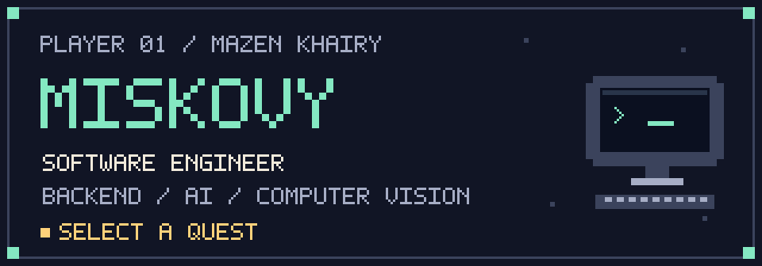
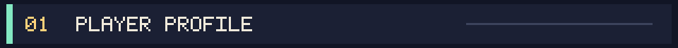
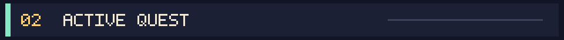
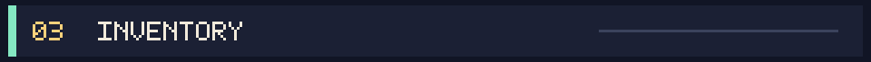
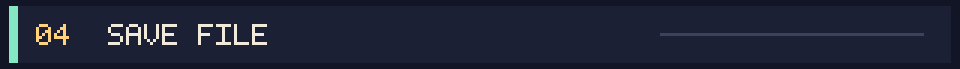
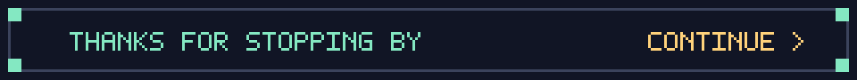

<!-- Original pixel artwork. Keep assets/retro beside this README. -->
<p align="center">
  
</p>

<p align="center">
  <a href="#player-profile"><code>01 PLAYER</code></a> &nbsp; · &nbsp;
  <a href="#active-quest"><code>02 QUEST</code></a> &nbsp; · &nbsp;
  <a href="#inventory"><code>03 INVENTORY</code></a> &nbsp; · &nbsp;
  <a href="#save-file"><code>04 SAVE FILE</code></a>
</p>

<a id="player-profile"></a>


I'm **Mazen Khairy**, a software engineer focused on **backend development**, with a strong interest in **machine learning and computer vision**.

I started with Visual Basic experiments and game development. These days, I build backend systems and explore how software works under the hood.

```typescript
const player = {
  name: "Mazen Khairy",
  handle: "Miskovy",
  mainStack: ["TypeScript", "Node.js", "NestJS", "Python"],
  interests: ["backend systems", "parallel computing", "computer vision"],
  firstSave: 2014,
};
```

<a id="active-quest"></a>


### [PJS — Parallel JavaScript Runtime](https://github.com/Miskovy/parallel-javascript)

Running explicitly registered CPU tasks in persistent Node.js workers, with bounded queues and explicit memory ownership.

I'm exploring the parts that make parallel computation useful in real applications: execution overhead, resource limits, worker lifecycle, and failure handling.

**[ENTER PROJECT](https://github.com/Miskovy/parallel-javascript)** · **[READ THE SCIENCE](https://github.com/Miskovy/parallel-javascript/tree/main/science)** · **[ALL PROJECTS](https://github.com/Miskovy?tab=repositories)**

<a id="inventory"></a>


| Slot | Equipment |
| :--- | :--- |
| `BACKEND` | Node.js · TypeScript · NestJS · Express · FastAPI |
| `DATA` | PostgreSQL · MySQL · MongoDB · Redis |
| `DEPLOY` | Docker |
| `FRONTEND` | React · Next.js · Tailwind CSS |
| `ERP` | Odoo |
| `AI / VISION` | Python · PyTorch · TensorFlow · scikit-learn · OpenCV |
| `TESTING` | Playwright · Selenium · Cypress · Jest · Appium |
| `GAMES` | Unity · Unreal Engine · Blender · C++ |
| `DESKTOP` | .NET · Java |

<a id="save-file"></a>


| Save | Chapter |
| :--- | :--- |
| `2014` | Started with Visual Basic: browsers, notepads, calculators, and simple games. |
| `2017` | Explored Unity and Unreal Engine. Created my first game, **The Cave Walker**. |
| `2021` | Moved into software testing and started freelancing. |
| `TODAY` | Building backend systems and exploring ML, computer vision, and JavaScript parallelism. |

<p align="center">
  Contributions and thoughtful discussions are welcome.<br>
  <a href="https://github.com/Miskovy?tab=repositories"><code>EXPLORE MY REPOSITORIES</code></a>
</p>

<p align="center">
  
</p>
