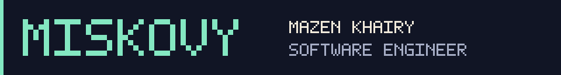

I'm **Mazen**, a software engineer focused on backend development, with an interest in machine learning and computer vision.

**Main stack:** `TypeScript` · `Node.js` · `NestJS` · `PostgreSQL` · `Docker`
<!--- 
Open Source Contributions

  
   
  <strong>NestJS · 1 merged contribution</strong>
  
<a href="https://github.com/nestjs/docs.nestjs.com/commit/56039e9f29fc97f450a7c6a6f7d046f725d8a7f9">- nestjs/docs.nestjs.com #3634 </a> — Fixed the Locks store contract documentation link.
--->
